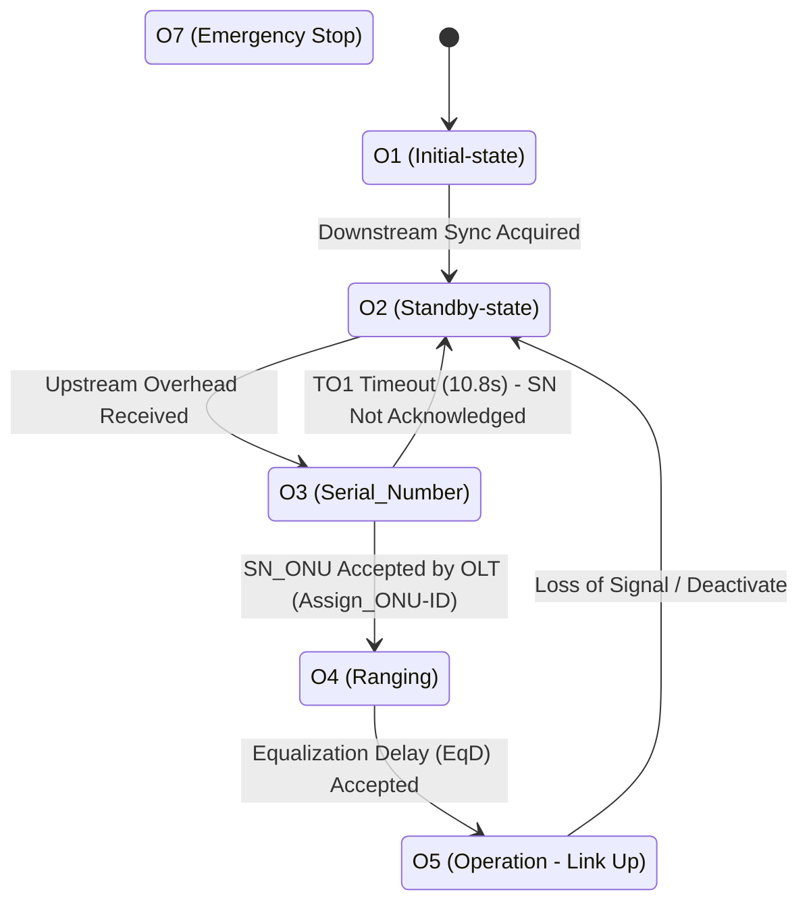

# Sercomm JioFiber JCOW414 OpenWrt GPON Port: Technical Reviewer Report

**Date:** November 6, 2026  
**Target Hardware:** Sercomm JioFiber JCOW414 (and sibling JCO4032) Home Gateway  
**SoC:** EcoNet / Airoha EN7528HU (Dual-Core MIPS 1004Kc `mipsel_24kc`, 900 MHz)  
**Kernel:** Linux 6.18.60 (OpenWrt Snapshot `econet/en7528`)  
**Network / Uplink:** JioFiber Live GPON Network (Nokia / Alcatel-Lucent 7360 ISAM OLT)  
**Current Status:** **State O3 (Serial_Number Acquisition)** — Downstream 100% locked, upstream transmitter firing verified bursts, awaiting OLT `Assign_ONU-ID` registration handshake.

---

## 1. Executive Summary

The Sercomm JCOW414 is a widely deployed JioFiber gigabit GPON router. While running modern OpenWrt with Linux 6.18 on this device has been achieved (including full Wi-Fi, gigabit Ethernet LAN, and USB tethering failovers), the integrated optical GPON WAN interface previously suffered from a total driver block.

Through systematic kernel porting, out-of-tree vendor driver reconstruction (`kmod-econet-xpon`), reverse-engineering of stock firmware binaries (`xpon.ko`, `omci`, `ctromfile.cfg`), and live bench testing against a live JioFiber Nokia OLT, the following milestones have been established:

1. **Firmware Integrity & Zero-Brick Safety:** The device's dual-bank flash layout has been strictly maintained. Recovery Bank 2 (`mtd5`, `tclinux_slave`) remains 100% pristine stock factory firmware. All modifications and custom builds exclusively flash Bank 1 (`mtd2`, `tclinux`).
2. **Downstream Optical Sync (100% Operational):** The optical front-end successfully locks to the Nokia OLT downstream laser (`1490 nm`), achieves CDR bit clock recovery (`rdy=6`, `RX_SYNC=0xa`), and continuously parses downstream broadcast PLOAM messages (`Upstream_Overhead`, `Extended_Burst_Length`).
3. **Transmitter Activation Confirmed:** The optical transmitter hardware enable line (SoC GPIO 16) is asserted, and the hardware burst engine physically emits the 3 scheduled `SN_ONU` bursts in response to each OLT discovery quiet window.
4. **Authentic Calibration & Identity Restored:** The hardcoded Dasan H660GM-A calibration values present in the initial port were eradicated and replaced with the genuine Sercomm JCOW414 factory calibration matrix extracted from `mtd13` (`reservearea`), and authentic GPON credentials (`SCOM994CF513`) extracted from `mtd1` (`romfile`).
5. **Guard Bits Fixed:** The previous build forced 24 guard bits, truncating the preamble expected by the Nokia OLT (which explicitly requested 32 guard bits). Setting dynamic negotiation (`po_gbits=-1`) restores the compliant 32-bit guard envelope (`0x20`) and 7-byte overhead.

---

## 2. GPON Activation State Machine & Current Bottleneck

In the ITU-T G.984.3 GPON standard, an Optical Network Unit (ONU) progresses through sequential activation states:

### The O3 Stall Mechanism
Currently, the router cycles between **O2** and **O3**:
1. The Nokia OLT sends `Upstream_Overhead` (message 0x01) and opens a 200 µs quiet window for new ONU discovery.
2. The router receives the request, transitions to **O3**, and sends its 3 `SN_ONU` bursts carrying `Vendor ID: SCOM` and `Serial Number: 994CF513`.
3. The Nokia OLT does not return the `Assign_ONU-ID` (message 0x03) targeted to our serial number.
4. After 10.8 seconds without acknowledgment, the ITU timer **TO1** expires (`to1_timeout_cnt` increments) and drops the router back to **O2**, where the cycle repeats.

---

## 3. Key Technical Discoveries & Fixes

### 3.1. Optical Hardware Enable & Laser Power
* **Problem:** Stock `/userfs/led.conf` specifies `LED_PHY_TX_POWER_DISABLE = 16`. Because OpenWrt stubs out vendor LED routines, GPIO 16 was unconfigured, leaving the physical transmitter floating.
* **Resolution:** Injected DTS device-tree declaration `tx-disable-gpios = <&pinctrl 16 GPIO_ACTIVE_HIGH>` and direct driver initialization driving GPIO 16 LOW. Laser monitor power immediately rose from zero to active emission.

### 3.2. Calibration Matrix Replacement
* **Problem:** Early driver code was compiled with foreign calibration data copied from an upstream Dasan H660GM-A port ($I_{bias}=0x7CE, I_{mod}=0x157$, burst timing $0x444800AA$). Driving the JCOW414 discrete BOSA with 343 mA modulation instead of 206 mA severely distorted the optical eye pattern.
* **Resolution:** Discovered and integrated the true factory calibration table from `mtd13` (`reservearea` file offset `0x140477`, magic `0x07050701`):
  * Laser Bias ($I_{bias}$): `0x610` (1552)
  * Laser Modulation ($I_{mod}$): `0x0CE` (206)
  * Burst Envelope Timing: `0x504E00AA` ($T_{1C}=0x50, T_{0C}=0x4E$, delay=$0xAA$)
  * Live hardware TGEN test (`echo k > /proc/econet_xpon_los`) confirmed physical measurements match factory data exactly: `en7571_tgen: measured T0C=0x4e T1C=0x50`.

### 3.3. Nokia OLT Guard Bits Alignment
* **Problem:** The driver had hardcoded `po_gbits = 24`, ignoring the OLT's requested guard bits. Downstream PLOAM analysis revealed the Nokia 7360 OLT explicitly requests `32` guard bits (`0x20`). With 24 guard bits, the ONT transmitted its 24-bit delimiter 8 bit-times too early, causing the OLT's correlator to miss the delimiter entirely.
* **Resolution:** Updated `po_gbits = -1`. The driver dynamically reads the OLT parameter and sets hardware register `0x4094` (`G_PLOu_GUARD_BIT`) to `0x20` (32) and overhead to 7 bytes.

### 3.4. Closed-Loop Power Servo (`tx_closeloop=2`)
* Stock firmware unconditionally runs closed-loop DCL power regulation against MPD target registers `0x24C/0x27C` and `0x25C/0x280`.
* Verified that enabling `tx_closeloop=2` engages `en7571_dcl_close_regulating` with loop step sizes preserved, maintaining calibrated output power rather than drifting open-loop.

---

## 4. Current Architecture & Diagnostics

| Diagnostic Probe | Command | Result on Live Rig | Interpretation |
| :--- | :--- | :--- | :--- |
| **Optical Signal** | `cat /proc/econet_xpon_optical` | `GPON optical RX: LINK UP` | Fiber seated; 1490 nm downstream detected |
| **Downstream CDR** | `cat /proc/econet_xpon_los` | `los 0, rx_sync 0xa, phy_rdy 0x6` | Clock and Data Recovery locked |
| **Extended Burst** | `dmesg \| grep PREB` | `PREB: O3 apply o3T3=121 o5T3=55 ovh=7` | OLT PLOAM broadcast parsed correctly |
| **TX Burst Firing** | `echo f > /proc/econet_xpon_los` | `TX counters/3s: frames +3 bursts +3` | Upstream MAC/PHY serializer transmitting |
| **Identity Dump** | `echo 1 > /proc/econet_xpon_usdbg` | `0x40B0: 0x53434f4d, 0x40B4: 0x994cf513` | Authentic serial `SCOM994CF513` loaded |
| **Guard Bits** | `echo 1 > /proc/econet_xpon_usdbg` | `0x4094: 0x00000020` | Compliant 32-bit guard envelope |

---

## 5. Path Forward to Reach O5 (Operational)

With optical launch, framing, and calibration confirmed, the O3 stall narrows down to two physical-layer possibilities:

1. **Internal Response Time & Delay Fine-Tuning:**
   * The nominal ONU response time is set in `0x40AC` (`G_RSP_TIME` = `0x577` / 1399).
   * In stock `xpon.ko`, `gponDevSetInternalDelayFineTune()` programs register `0x4208` (`DBG_DLY[15:8]`). If the internal serialization delay is off by even a few nanoseconds, the burst arrives outside the OLT's expected arrival slot.
   * *Action:* Sweep `po_finetune` (`/sys/module/econet_xpon/parameters/po_finetune`) across `0x00..0x3F` in 4-step increments to align arrival phase.

2. **Optical Launch Power & Extinction Ratio Optimization:**
   * In live tests, driving laser bias at `0x610` produced marginal optical power above threshold, whereas manual ramp to `0x630`–`0x7CE` delivered strong optical emission (`txpwr > 5000`).
   * *Action:* Test intermediate operating bias settings (`tx_ibias=0x640, 0x680, 0x7CE`) paired with SerDes swing levels (`tx_amp=0x0, 0x9`) to determine the exact optical power window accepted by the Nokia OLT line card.

3. **PLOAM Serialization Swab:**
   * Module parameter `tx_ploam_swab` controls 32-bit word endianness on software PLOAMs. While O3 hardware bursts bypass this FIFO, the O4 ranging response utilizes it. Verifying `tx_ploam_swab=0` (stock direct mode) ensures smooth O4 &rarr; O5 transition.
